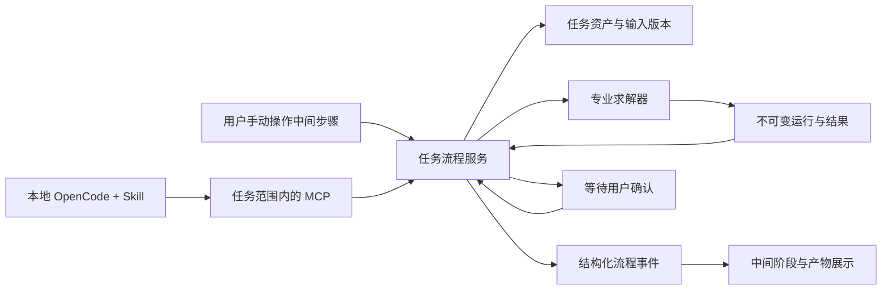

# 任务隔离、Agent 联动与迁移部署建议

日期：2026-10-11。状态：待讨论的设计建议，尚未实施。审视依据：原始需求、项目工作计划、已有设计/计划文档和当前代码基线 `4da4d11`。本轮只新增文档，没有修改系统代码、配置或数据，也没有使用提供的密钥。

建议把**评估任务作为系统主对象**：每个任务有独立输入、设计、流程、运行、报告和关联会话；中间手动操作与右侧 Skill 自动操作共用同一流程服务。先完成这一基础，再完善公共资产审核和独立分发。继续使用本地 OpenCode 官方界面，通过适配器关联工作台。

## 1. 当前问题及原因

| 用户问题 | 当前实际实现 | 影响 |
|---|---|---|
| 会话是谁、对应什么评估 | 会话创建标题固定为“可靠性设计评估”；按 OpenCode 项目目录过滤后全部列出 | 同名会话难区分，目录不等于评估任务 |
| 切换会话后设计是否隔离 | 工作台读取最后保存的全局设计；会话编号只是其中一个字段 | 切换聊天不等于切换评估上下文 |
| 官方界面会话与外层关联 | 官方 iframe 内部导航与外层选择器分别维护 | 用户可能正在看另一个会话，却同步到外层选择的会话 |
| 中间步骤与 Skill 有何关系 | 中间提交阶段记录；外层从聊天工具输出识别阶段和运行编号 | 有局部联动，没有统一且可恢复的自动执行流程 |
| 公共资产是否经过严格审核 | 支持草稿、校验、发布、版本及固定引用；MCP 暴露发布工具 | 格式校验不等于证据审查或独立审批 |
| 工具能否单独复制使用 | MCP 服务代理工作台 API；配置命令使用仓库内相对路径 | 只复制 Skill 或 MCP 目录不能得到完整可运行能力 |

主要代码依据：[OpenCode 适配](../packages/agents/src/opencode-adapter.ts)、[会话面板](../apps/web/src/OpenCodePanel.tsx)、[工作台](../apps/web/src/App.tsx)、[API](../apps/api/src/server.ts)、[资产存储](../packages/assets/src/store.ts)、[MCP 工具](../apps/mcp/src/server.ts)、[Skill](../skills/sd-dfr-remap/SKILL.md)。数据库目前没有任务归属字段；`/workflow` 读取最后一条流程记录，没有按任务和执行汇总整条状态链。

## 2. 任务管理：推荐范围与使用体验

三种路线：

| 路线 | 收益 | 局限 | 建议 |
|---|---|---|---|
| A：会话改名和分组 | 很快改善列表 | 全局设计与数据仍混用 | 只能作为临时缓解 |
| B：任务工作区、资产快照、统一流程 | 解决归属、复现、自动执行和迁移基础 | 需要调整数据与 API 契约 | **首选** |
| C：直接建设企业多租户平台 | 可提供团队身份和权限体系 | 当前原型范围扩大，集成成本高 | 保留接口，后续对接公司平台 |

这里的任务管理是可靠性评估工作区，不扩展成通用项目管理系统。默认先服务本地单用户、多任务、多窗口；公共共享和团队审核采用独立身份与服务。

### 2.1 分清四类对象

- **评估任务 Task**：一个明确决策问题，记录产品类型、规模、目标指标、窗口、代际及范围。任务名称如“万卡训练集群 · 某代际恢复方案选型”。
- **方案 Scenario/Scheme**：任务内的基线与候选。相同产品要求下，不同方案用相同目标比较；多代际可在同任务内对比，范围变化较大时复制任务并建立对比组。
- **运行 Run**：某个输入版本的一次不可变计算。任务内可以有很多运行，保留求解器版本、种子、输入摘要和结果。
- **会话 AgentSession**：辅助完成任务的讨论入口。一个主会话，必要时增加具名专题会话；会话本身不拥有或定义任务。

### 2.2 推荐交互

进入系统先看到任务列表，可“新建任务”“打开任务”“复制任务”。新建时选择 AI 训练集群、AI 系统、NTN 或其他产品模板；尚不支持的模型明确标注待扩展。

打开任务后，顶部始终显示任务名、规模/指标、当前方案、流程阶段和最近运行。左侧所有业务页签自动限定当前任务，另设“公共资产库”入口。

右侧默认打开该任务主会话，例如 `T-0042 · 万卡恢复方案 · 主会话`。普通用户不再看到同目录下所有 OpenCode 会话。专题会话显示用途和最后活动；旧的未关联会话进入独立的“历史会话待整理”视图。

官方界面内部若跳到未关联会话，不能自动继承任务写入权限；外层展示关联状态并提供返回入口。绑定必须经服务端核对会话、工作目录和任务清单。不能把读取 iframe DOM 当作可靠关联方式，也不能仅凭模型输出的任务编号获得权限。

切换任务恢复它的设计、文件、私有资产、步骤、运行、报告和主会话。后台计算继续属于原任务，结果不得改变新任务的页面状态。浏览器多窗口也必须各自绑定任务，不能在服务器设一个全局 `currentTask`。

从现有界面截图看，右侧同步的完整 JSON 会占据大量聊天空间，中间也容易把“正在查看阶段”“已人工确认”“计算已完成”看成同一件事。建议同步消息只显示任务摘要、输入版本和产物引用，完整内容通过任务工具读取；中间明确区分查看、待确认和已完成状态，显示下一步动作、缺失项与产物卡片。保留三栏结构，支持拖动宽度和放大 Agent，长参数与计算详情默认折叠。原生聊天内部的显示遵循官方能力，不依赖修改其 DOM。

### 2.3 数据隔离

建议工作区布局：

```text
workspace/
  public-catalog/                 # 已审核发布版本
  tasks/<taskId>/
    task.json                     # 身份、范围、版本、关联清单
    inputs/                       # 原始资料与确认版本
    assets/                       # 私有草稿及复制的公共快照
    models/                       # 结构、参数、方案版本
    workflow/                     # 阶段记录、事件及确认
    runs/                         # 运行快照与产物
    reports/
    agent-manifest.json           # 会话绑定，不含 API Key
```

任务内数据访问由服务端校验身份、任务范围和版本。MCP 连接上下文固定授权任务，工具参数中的 `taskId` 不能越权。文件路径只能解析到授权根目录内，需防止相对路径、符号链接和 Windows junction 绕过。

独立目录提供组织隔离，但同一操作系统用户下的 Agent shell 仍可能访问其他目录；OpenCode 的外部目录询问不是强制安全沙箱。需要严格安全隔离时，使用独立服务身份、文件权限或容器。公司多人使用不能把当前无认证的本地 API 直接开放到网络。

## 3. 公共资产：复制使用、审核回流

支持故障模式库、机制库、参数证据库、场景模板库、验证案例库和故障事件台账，但每项应有明确的**私有/公共范围**。

从公共库使用资产时，复制指定发布版本到任务目录，保存 `upstreamId/revision/contentHash`、本地资产编号、来源、适用条件及 schema 版本。任务引用自己的固定快照，编辑产生私有派生版本。公共库更新时提示差异，由用户选择升级并重算，不自动改变旧任务或报告。

推荐回流流程：

```text
任务私有草稿 → 提交候选 → 技术校验 → 领域与证据审查
             → 独立审核批准 → 发布公共版本
任一审查失败 → 退回修改 → 重新提交与审核
```

技术校验检查 schema、单位、引用完整性、模型映射和可复现性。领域审查检查 FIT 的统计暴露、软件故障发生口径及传播、机制覆盖率/恢复效果、样本与置信范围、适用产品条件、共因假设、证据来源及允许共享范围。

审核必须绑定内容摘要；修改内容使原审批失效。提交人、审查人、批准人和意见进入审计记录。Agent 可以准备提案和检查资料，**不能通过普通 MCP 发布公共资产**。公共发布使用单独权限服务，服务端执行规则，而不是只在 Skill 中提示“谨慎发布”。

本地单用户可提供人工检查清单和显式批准，但不能把自审称为独立专家审核。如果必须满足严格独立审核，在接入真实审核身份前，应关闭公共发布，先允许任务内复用和候选提交。已有格式校验通过的资产不能自动视为经过新审核。

## 4. 模型切换：GLM-5.3

当前右侧已经嵌入本地 OpenCode 官方界面，模型和提供商由它管理。官方支持自定义 OpenAI 兼容提供商，模型可在原生界面选择。[OpenCode 提供商文档](https://opencode.ai/docs/providers/)

配置目标：提供商命名为“智谱 Coding Plan”，Base URL 使用 `https://open.bigmodel.cn/api/coding/paas/v4`，模型 ID 使用用户指定的 `glm-5.3`。Base URL 不额外拼接具体请求资源。通过官方设置输入密钥，不在任务、报告、软件包或聊天同步快照中保存密钥。

如果安装版本的自定义界面不能完整登记模型，后续可在保留现有 MCP 和权限配置的前提下，**合并**以下 provider 段；这是配置建议，本轮没有写入：

```json
{
  "provider": {
    "bigmodel-coding": {
      "npm": "@ai-sdk/openai-compatible",
      "name": "智谱 Coding Plan",
      "options": {
        "baseURL": "https://open.bigmodel.cn/api/coding/paas/v4",
        "apiKey": "{env:BIGMODEL_CODING_API_KEY}"
      },
      "models": {
        "glm-5.3": { "name": "GLM-5.3" }
      }
    }
  }
}
```

密钥由启动 OpenCode 的进程环境或其本地凭据存储提供，不填写进上述文件。配置加载后在官方模型菜单选择登记的模型；如需要默认模型，才另外设置默认项。`OPENCODE_MODEL` 当前仅影响兼容的 HTTP 调用，不覆盖官方输入框的模型选择。

智谱官方提供 Coding Plan 工具助手并列出 OpenCode 支持，但这不证明该账户能调用指定模型。[智谱工具助手说明](https://docs.bigmodel.cn/cn/coding-plan/extension/coding-tool-helper)

**未确认项：**`glm-5.3` 的账户授权、该端点实际支持、工具调用、流式输出、上下文限制与视觉能力。本轮没有调用该模型，不能承诺接入测试已通过。后续验收依次验证连接、简单对话、一个无敏感数据的只读 MCP 调用、一次小型求解、错误和重连。不要仅以聊天成功判断 Skill 可用。

工作台可以维护“模型用途配置”：对话、文件提取、复杂推理分别选择逻辑配置名。原生 OpenCode 仍负责聊天密钥和模型交互；提取器的 `MODEL_*` 当前是另一套配置，不能因为模型名相同就假定自动共用或具备图像解析能力。只显示不含凭据的模型元数据和能力验证状态。

## 5. 中间步骤与右侧 Skill：两种入口、同一流程

**中间负责过程可见、人工编辑和确认；右侧负责理解需求、组织执行和解释。** Skill 定义方法、步骤和证据要求；Agent 选择并调用工具；工具完成确定性计算。Skill 文件自身不是调度器，不能单靠指令保证自动执行、状态一致和恢复。

推荐关系：



六阶段保留：确认目标、描述系统、选择方法、准备参数、求解权衡、验证交付。每阶段记录输入版本、产物、执行者、确认与失败原因。状态至少覆盖待输入、就绪、执行中、待确认、完成、失败、取消。

Agent 开始时通过工具读取**绑定任务的当前设计和版本**，不能只从旧聊天快照猜测。中间订阅工作台的领域事件，按 `taskId/workflowId/executionId/stepId/sequence` 显示进度；不再从聊天文本或供应商工具片段猜测可靠性状态。

用户可选择人工执行、逐步辅助或自动到确认点。自动执行时，架构描述、故障域、参数表、方法理由、运行进度和报告逐步显示。未知数据、单位歧义、关键假设及公共发布必须停在可审查的确认点；确认后继续，支持取消、失败重试和重启恢复。

例如：“比较万卡训练的两种恢复策略”。右侧澄清目标和资料，中间显示待确认任务书；确认后解析文件并显示结构与缺失项，再提出方法；确认参数后执行配对比较，显示收益与风险，最后产出待签认报告。聊天不会另起一套看不见的评估过程。

如果用户在 Agent 执行时修改参数，提交必须携带预期输入版本，发现冲突则暂停，保留旧运行，不覆盖新设计。自动流程不可把“工具执行成功”自动变成“用户确认事实成立”。

## 6. 迁移与独立分发

**别人安装本地 OpenCode 是必要条件之一，但还不足以开箱即用。** 当前发布包需要 Node/pnpm、Python 科学依赖、正确工作目录、工作台 API、Skill/MCP 配置及模型凭据。还没有在另一台干净电脑完成冷安装验收，也没有完整离线官方 Web 资源保证。

建议拆为可独立版本化的四层：

| 层 | 独立交付物 | 依赖关系 |
|---|---|---|
| 领域与求解 | contracts、可靠性引擎、求解插件、验证样例 | 不依赖 Agent 或 LUI |
| MCP 工具包 | 标准工具契约与可执行入口 | 连接评估 API，或打包必要服务提供独立模式 |
| Skill 包 | SKILL.md、流程参考、样例、工具需求清单 | 需要 Agent 支持 Skill 与相应 MCP 工具 |
| 工作台与 Agent 适配 | LUI、流程服务、本地 OpenCode 适配 | 替换 Agent 时保留任务与求解层 |

工具传输采用标准 stdio / Streamable HTTP，不把 OpenCode 协议当工具协议。[MCP 传输规范](https://modelcontextprotocol.io/specification/2025-11-25/basic/transports)

Skill 使用规范化文件和相对引用；`/sd-dfr-remap` 是 OpenCode 命令入口，其他 Agent 需按其发现机制适配，并非所有 Agent 都支持相同斜杠命令。[OpenCode Skill 文档](https://opencode.ai/docs/skills/)

首次启动向导应检查依赖、Python 实际导入、本地 OpenCode 版本/地址、端口、MCP 握手、示例计算和可写数据目录；生成本机绝对路径配置，不硬编码开发者电脑路径。允许无 Agent 的手动数值评估；缺少 CTMC 依赖时清楚标记该能力不可用。

软件包与任务包分开导出。任务包包含版本化输入、资产快照、方案、流程与报告，不含密钥；是否导出聊天由用户选择，并受原生 Agent 的导出能力限制。新机器不能假定旧会话编号可用，应恢复任务后创建/重绑会话，通过任务摘要接续。数据库用停止服务后的完整备份或 SQLite 在线备份接口，不能只复制正在写入的主数据库文件。

旧全局工作区迁移为一个“历史任务”，保留原运行与哈希；用户已有资产先作为该任务私有资产，不自动提升为公共版本。迁移先做预检、备份、清单和可回滚验证。

## 7. 实施优先级与可信性

1. 任务身份、工作区、API/MCP 范围约束和旧数据迁移；同步限制公共发布。
2. OpenCode 任务会话绑定与模型接入验证，解决日常使用混乱。
3. 共用流程服务及结构化事件，实现“右侧执行、中间逐步展示”。
4. 公共资产严格审核、派生关系与显式升级。
5. 独立 Skill/MCP 包、安装向导、任务迁移、第二台电脑验收。

不沿用旧工作计划的时间节点；按可验收的能力推进，AI 可以加速实现，但不能省略任务隔离、模型调用和迁移验证。

这些工作主要提升工程可用性和可追溯性。“超过业界”的科学可信度仍需要另一条证据链：公开基准与解析解验证、现场参数校准、独立故障注入/历史回放、模型偏差和不确定性分析、方案排序稳定性。自动化成功率、用户接纳率用于改进交互和流程，不能替代可靠性预测准确度；改进建议先评估再发布，不能自动修改公共方法。

详细任务与验收见[实施计划](superpowers/plans/2026-10-11-task-workflow-portability-plan.md)，实际操作见[使用指南](2026-10-11-评估系统使用指南.md)。
