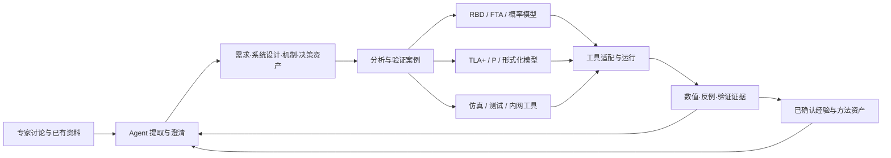

# ReMAP：Agent 辅助系统设计与可靠性分析验证框架

日期：2026-10-13。状态：用户已认可；首条 AI 集群工程闭环已实施，范围与实测证据见[实施计划](../plans/2026-10-13-agent-engineering-loop.md)。

本文替代早期“多视图画布”作为主架构；原稿中的单位、概率、任务隔离、版本冻结和图形交互要求继续作为适用约束。本文同时包含后续演进方向，不表示所有方法、复杂图形和企业工具已实现或验收；本轮实际范围见[使用与适配指南](../../2026-10-13-Agent工程闭环使用与适配.md)。

## 1. 平台定位与本次纠正

ReMAP 面向系统可靠性设计、建模、评估与验证。通过 Agent 交互，帮助专家把已有资料、讨论中的假设、可靠性机制和设计取舍逐步沉淀成可维护、可分析、可验证、可复用的工程资产。

系统设计资产是分析的依据，也会因分析发现而迭代。RBD、FTA、形式化模型等是针对问题形成的分析/验证模型；各有不同语义，不能仅视作相同模型的几种画法。绘图是专家表达和理解模型的一种入口；方法、模型、执行工具、结果和证据要分别管理。

用户已明确：公司内网已有部分方法工具，外网先搭通用框架，之后在内网完成适配与 AI 化。保留既有工具的专业算法与原生模型，框架负责上下文、资产关联、工作流和工具衔接。

已确认需求：

- 专家可以从 PPT 图、文档、文字讨论及现有模型起步，快速得到可修订的设计资产。
- 支持系统架构、组网、部署、功能行为及相关时序，而不只是结构图。
- 同时保留硬件/软件/网络等故障来源和中断/降级/静默错误等影响维度。
- 支持 RBD、FTA、BDD，以及 TLA+/P 等形式化工具的框架接入。
- Agent 帮助澄清、建模、调用工具和解释反馈；专家能够方便地确认关键语义与设计取舍。
- 企业资料、原生工具、模型调用与验证数据留在公司内网。

## 2. 概念与职责

| 层次 | 工程对象 | 主要问题 | 在平台内如何呈现 |
| --- | --- | --- | --- |
| 意图与要求 | 目标、需求、约束、任务场景、成功/失败判据 | 要满足什么、在哪些条件下满足 | 目标/需求卡、场景、验证性质 |
| 系统设计 | 架构、部署、网络、接口、行为、协议、机制及取舍 | 系统由什么组成、怎样运行、为何这样设计 | 图、表、时序、状态、决策记录 |
| 方法与模型 | RBD、故障树、FMEA、CTMC、TLA+/P 模型等 | 用何种抽象回答哪个问题 | 方法专用图/表/源文件和建模假设 |
| 工具执行 | 求解器、模型检查器、仿真器、测试器、内网工具 | 怎样计算或检查 | 运行任务、环境、输入快照、日志 |
| 结果与证据 | 数值、反例、检查范围、测试记录、校准数据 | 得到了什么、有何适用边界 | 结果视图、反例时序、证据链接 |
| 经验与复用 | 经确认的模式、方法步骤、案例、禁用条件 | 下次怎样更快且更可靠地复用 | 模板、方法包、机制资产与反例库 |

几个精确区分：

1. RBD 是成功逻辑建模与分析的一种方式，可靠性框图是模型的图形表达，也是分析输入；数值可靠度、可用度等才是具体求解结果。静态和动态扩展的适用性要由工具能力声明。
2. FTA 是从指定顶事件向下分析致因的方法；故障树是形成的分析模型，不应由架构层级机械替代。模式、原因、事件和概率需要明确语义。
3. BDD 是布尔函数的表示及相应算法基础，可以作为 FTA/RBD 等的求解表示，也可以提供专家检查视图。现有 ReMAP 的 BDD 就承担精确共享事件求解职责，不强制成为普通用户必须编辑的独立图。
4. 用户提到的 TLA 在工具落地时通常具体为 TLA+ 及其 TLC/TLAPS 等工具；P 是以通信状态机建模的语言与工具链。形式化模型、性质和检查配置一起构成验证输入。工具返回反例或特定范围内的检查/证明结果，不直接等同于失效率、可用度或现实系统正确性。
5. 功能流、时序和状态模型互补：活动依赖、参与者交互次序、状态转移不是同一种数据。时序中的消息、超时和并发对机制正确性尤其重要。

行业依据：SysML v2 明确区分视图、分析案例和验证案例；ReMAP 借鉴这种分层，首轮不承诺完整 SysML 标准实现或认证。方法细分参考 ReliaSoft、NASA、TLA+ 和 P 官方资料，见末尾来源。

## 3. 总体关系：共享工程语义，保留方法专用模型



同一“检查点恢复”机制可关联：架构中的协调服务、部署中的存储故障域、功能时序中的提交与恢复交互、RBD 中的依赖条件、FTA 中的恢复失败分支、P 模型中的状态机、TLA+ 中的一致性性质，以及真实恢复测试。它们共享身份与来源，但不声称是可无损互换的同一个模型。

架构到分析模型的映射必须记录“哪些对象/行为被纳入、哪些被抽象或排除、采用哪些假设、用于哪个问题”。允许多个模型抽象同一系统；也允许分析发现推动设计修改。

## 4. 专家使用闭环

主入口是“我要设计、解释或判断什么”，而不是先要求专家填完一套 schema 或选择一个求解器。

建议交互如下：

1. 专家提交现有资料或描述当前方案。Agent 提取组件、关系、行为、机制、参数和术语，保留每项来源。先呈现可用草图与已知事实。
2. Agent 按当前任务提出少量会影响结论的问题。例如“两个备用节点是否共用交换机”“超时后旧协调器还能否提交”。缺失参数先显示缺口，不编造数值。
3. 专家用对话或图上直接修改。Agent 生成同一份结构化变更草案，并显示差异和影响范围。对话、图和表都调用同一领域命令，避免三套状态。
4. 形成方案版本，记录采纳与否、原因、适用条件及待验证假设。一次确认可以接受一组相关变更，减少逐字段操作。
5. 从问题推荐方法，并说明理由。例如“量化不中断概率”使用 RBD，“追查恢复失败组合”使用 FTA，“查找并发提交错误”使用 P/TLA+。
6. 生成或更新方法专用模型，调用真实工具。Agent 将数值、错误、反例关联回源设计对象和需求。
7. 专家据此修订设计，或确认适用范围内的结论。将审阅过的机制、方法步骤和反例保存为可复用资产。

直接绘图、JSON/原生源码编辑、已有模板导入均可独立使用。模型服务不可用时，手工建模与本地工具仍应运行。首次建立不完整的系统资产允许保存，只有依赖缺失内容的分析才受阻。

## 5. 沉淀哪些资产

| 资产 | 必要内容 |
| --- | --- |
| 来源材料 | 原文/原图、文件摘要、页码/形状/消息/段落定位、版本、任务归属 |
| 工程事实与待确认陈述 | 具体主张、来源、适用场景、支持/冲突记录及确认状态 |
| 系统设计 | 稳定对象与关系、接口、部署实例、故障域、行为与场景 |
| 可靠性机制 | 目标故障、作用过程、前提、依赖、代价、残余风险和实施状态 |
| 设计决策 | 备选项、评估准则、收益/成本、采纳理由、放弃理由、重审触发条件 |
| 方法包 | 适用问题、所需输入、抽象规则、步骤、工具需求、检查性质、解释规范及示例 |
| 分析/验证模型 | 方法类型、原生源文件、与系统的映射、假设、参数/性质与工具配置 |
| 运行与证据 | 冻结输入、工具版本、参数/边界/种子、原始输出、标准化结果、结论范围 |

可靠性方法包不等同于一段提示词。Skill 可以指导 Agent 使用方法包；方法包还必须包含可检查的契约、适用条件和案例。MCP 暴露调用能力，工具适配器负责真实执行，资产记录工程语义和历史。

草稿、专家确认、工具已检查、实际系统验证是不同维度。AI 提取置信度不能代替工程证据；专家确认的假设也不能自动标为已被实测证明。

知识复用默认检索专家已确认的版本；草稿、冲突和被否决方案仍保留状态。新任务引用资产版本，不自动把所有旧参数当作适用于新环境。所谓良性循环首先是有来源的资产复用与规则改进，不默认进行模型训练或上传知识库。

## 6. PPT 与快速变化的设计

现有 `packages/ingestion/src/parser.ts` 已处理 JSON/CSV/XLSX/文本/PDF 文本/图片相关输入，并有模型提取入口，但尚不支持 PPTX 结构解析；真实提取模型调用也不能视作本轮已验收。

新框架应支持以下路径：

- PPTX 原生解析提取文本、形状、显式连接器、备注及源定位；图片型页面通过配置的内网视觉模型提出候选对象和关系。
- 保留原始文件和页面预览，专家可点开“这个组件/关系从哪里来”。几何靠近或线条交叉不能自动断言为工程连接。
- 同名候选对象由上下文和来源协助匹配；匹配不确定时提示合并/新建选择。名称不等于稳定 ID。
- 新版资料导入形成增量差异，显示新增、修改、删除候选和受影响的模型/结论。旧资料未再次出现的对象不能直接自动删除。
- 支持把当前设计图和说明导出为评审可用的图片/文档；PPTX 输出可先嵌入图并附来源/版本，不能宣称原生形状无损往返。

首轮 PPT 价值目标是“已有材料可作为持续建模入口”，不要求专家先放弃 PPT，也不承诺任意 PPT 都能全自动准确转成可计算模型。

## 7. 图与模型的前端组织

任务工作区分为“设计资产”“分析与验证”“证据与决策”，共享对象搜索、来源查看和关联跳转。具体导航需兼容现有训练六阶段与任务主页，不另造一套替代全部流程的固定向导。

设计资产包括架构/组网、部署、功能活动、交互时序及状态。时序最小模型独立包含参与者、生命线、消息/事件、先后约束、条件、超时与并发片段。设计时序、模型检查反例、真实运行日志分别标明来源，不能混成“实际发生”。

分析区按方法提供专用表达：RBD 成功路径、FTA 顶事件与逻辑门、FMEA 表格、形式化源码/性质/配置，以及状态/反例视图。BDD 默认作为高级求解详情；可按实际工具能力展示原生 BDD 结构，不能把原始故障树重画后命名为 BDD。

架构画布可以选用 React Flow；时序、故障树和形式化源码采用各自适合的渲染与编辑器。共享领域对象和交互命令，不强制复用一种节点画布实现所有方法。

## 8. JSON 与原生文件共存

“统一 JSON”指统一交换清单、元数据、对象、来源和关联契约。系统设计及结构化模型可直接存 JSON；TLA+/P/企业工具原生内容保留为文件，JSON 通过相对路径、媒体类型、摘要和版本引用它们。小型文本可以以内嵌文本字段交换，但不能仅保存一幅截图替代可执行模型。

概念包结构：

```text
manifest.json                  包版本、对象/资产索引、摘要和关联
design/*.json                  系统对象、行为、机制、要求与决策
views/*.json                   视图布局及显示引用
models/<model-id>/model.json    方法、来源映射、假设、内容引用
models/<model-id>/*.tla|*.cfg    TLA+ 原生模型与检查配置（按案例存在）
models/<model-id>/*.p|*.pproj    P 原生模型、性质与测试配置（按案例存在）
runs/<run-id>/result.json       结构化结果、范围与来源
sources/                       任务内原始材料
evidence/                      原始工具输出、反例和测试证据
```

这是待实现的包契约示意，不是现有目录已具备相应文件。JSON 为版本化公开契约，原生文件按工具版本保存；导出路径只允许包内相对路径。

建议模型/资产描述字段：`id`、`kind`、`revision`、`schemaVersion`、`sourceRefs`、`systemRefs`、`contentRefs`、`assumptions`、`status`、`createdBy`。分析/验证案例另有 `question`、`methodId`、`modelRef`、`propertyRefs`、`toolRequirements`、`scope`。分析模型不强制拥有 RBD 的 successTree。

共同 ID 支撑跨图和跨模型追溯；显示实例 ID、真实实例 ID、随机事件 ID、时序事件 ID 和形式化变量名各有映射，不混用。视图布局修改不改语义摘要；模型、参数、性质和抽象假设修改需要新版本。上游变更标记下游待复核，保留旧快照，不能静默同步覆盖手工维护的原生模型。

## 9. 方法与工具适配框架

代码核对：现有 `packages/extensions` 只实现管理员本地输入映射；求解器和报告插件尚未实现。现有 `AgentPort` 可替换 Agent 后端；独立 MCP 网关可复用任务级接口。新框架应在此基础上扩展，而不声称已有全部插件能力。

需要分离三个契约：

1. **方法包**：说明回答什么、需要哪些信息、如何抽象、如何解释结果。
2. **模型转换/准备适配器**：把某版本工程资产与问题转换为候选原生模型，或接收专家已有模型；返回映射、未决项与转换版本。
3. **工具适配器**：执行指定原生工具并提取结果；相同方法可换工具，相同工具可支持不同案例。

工具接口建议包括 `describeCapabilities`、`validateInputs`、`prepare`、`start`、`getStatus`、`cancel`、`collectArtifacts`、`normalizeResult`。声明输入/输出 schema、指标/性质支持、建模假设、资源限制、工具版本和环境要求。

调用模式涵盖受控本地 CLI、内网 HTTP API、以及文件提交/结果导入。文件模式可用于暂时不能自动执行的已有工具，界面必须标为等待外部执行。厂商原始输出仍保留，标准化解析失败不丢弃它。

MCP 只作为 Agent 调用这些领域能力的接口，不代替适配语义。HTTP/CLI 文件参数由管理员安装的适配器决定，用户模型数据不能成为任意 shell 命令。长任务进入运行队列，在独立工作目录/进程中执行，并支持取消、超时、输出上限及失败恢复；不沿用输入映射模块在 API 进程内执行的方式运行模型检查器。

运行状态与结论分开：工具正常退出可能找到反例，也可能只完成有界搜索。结果联合类型至少包括数值指标、性质检查结论、反例/轨迹、诊断、未知/未完成。必须记录检查模式、状态/调度范围、边界、种子、公平性等实际适用信息；超时不能变成“通过”。

内网适配步骤是安装工具适配包→配置本地程序或内网服务→运行合成契约测试→用企业基准验证语义→接入企业案例。外网使用公开/合成案例验证框架和真实公开引擎；模拟适配只测试协议路径，不能被计入真实工具验收。

## 10. AI 辅助的职责与验证

Agent 负责提取、澄清、提出设计/模型改动、准备工具输入、调用检查、解释结果和维护追溯。数值由求解器产生，检查结论来自验证工具；专家判断问题、抽象和假设是否反映真实系统。

基于近期实践，采用“生成候选→编译/校验→解释反馈→修订→再次检查”的有限循环。修复编译错误与改变系统行为要分开记录，给每次运行保留模型差异。达到预算或无法消除语义歧义时返回具体问题。

特别防止为了通过检查而削弱目标：不能自行删除不变量、放宽成功阈值、缩减故障空间、改掉环境假设，或把模型检查反例当作程序语法错误自动抹去。性质和目标单独版本化；这类修改必须作为设计决策呈现，并遵守既有人工确认规则。

评估 Agent 不能只看“生成了多少模型”或“工具是否通过”。验收至少包括：

- 从合成资料抽取对象/关系的精确率、漏项和来源定位正确性。
- 专家修改量、从材料到首个可用模型的用时、关键问题提问是否必要。
- 故意植入的错误能否被发现，反例能否定位到正确机制/行为。
- 专家否决的假设是否被保留并避免再自动应用。
- 更新资料后，正确定位受影响模型和结论；不误删来源之外的工程资产。
- 不改变已批准性质的情况下完成编译修复；不能靠降低要求取得通过。
- 实际模型推理、模拟 Agent、真实工具、模拟适配器的测试结果分别统计。

## 11. AI 集群主线示例

例：专家提供一张双协调器、训练节点与检查点存储的 PPT，提出“故障时自动切换，避免训练中断或回退错误”。

- 设计资产：组件、网络与故障域、部署关系、正常提交及故障恢复时序。
- 澄清问题：旧协调器是否被隔离；谁有提交权限；检查点写入何时算完成；消息延迟/丢失模型；切换成功判据。
- RBD：在明确假设下分析组件/路径失效对指定任务的影响；使用适用的失效率和任务窗口。
- FTA：围绕“无法恢复训练”或“恢复到了不一致状态”形成各自顶事件和原因组合。
- P/TLA+：例如检查“同一代检查点至多有一个有效提交者”等性质，并在明确公平性、故障假设和检查范围下分析恢复行为。
- 证据：将模型反例转成带来源标识的交互轨迹，专家决定增加隔离令牌等机制；测试/日志随后验证实现行为是否符合模型中的性质。
- 取舍：记录新机制的恢复时延、性能与复杂度成本；不能仅以形式化性质通过代替整体训练收益评估。

这些是合成示例和预期能力，不是已发现用户系统缺陷，也不是已证明某个实际 AI 集群方案正确。

## 12. 外网搭建顺序与验收边界

按可用闭环推进；每一步有实际资产和可检查产物，不以菜单占位代表完成。

1. **工程资产与专家交互底座**：需求、对象、机制、行为/时序、决策、来源、版本；Agent 结构化变更与差异确认；支持从合成 PPT/文档建立初稿。
2. **设计表达与已有分析闭环**：架构/组网/部署/行为视图，RBD/FTA 专用模型编辑与既有 BDD 求解接入，保留共享事件与单位约束；结果定位到设计资产。
3. **通用工具适配与形式化样例**：先以一个公开形式化工具跑通原生模型→性质检查→真实反例→设计修订链路，另一个提供独立的原生资产/接口契约；两者的已运行范围分别说明。最终选用 TLC 或 PChecker 取决于本机依赖和第一条验证案例，不能用模拟结果替代真实执行。
4. **内网接入模板与验收包**：CLI/API/文件适配示例、版本化输入输出契约、方法 Skill、合成基准、真实/模拟运行标识、迁移指南；公司已有工具在内网接入并验收。
5. **知识持续维护**：资料修订检测、受影响模型提示、方法包与案例复用、验证记录回流。已有人工签认与公共发布边界保持适用。

这次概念修订提高了 Agent 交互、原生模型管理和工具框架的优先级，不能只完成绘图就宣称交付。完整 SysML/UML 标准工具、任意原生格式无损转换、任意架构自动证明以及所有企业工具的真实集成仍需分别验收。

## 13. 研究与工程参考（2026-10-13 核查）

以下区分来源所述能力与 ReMAP 的设计判断。未在本机安装/试用这些外部项目，不将公开介绍当作本项目已验证能力。

| 来源 | 核实信息 | ReMAP 采用的设计启示 |
| --- | --- | --- |
| [OMG SysML v2 规范](https://www.omg.org/spec/SysML/2.0/Language/PDF)，§7.23、7.24、7.26 | 分别规定分析案例、验证案例、视图与视点 | 共享工程语义，但区分模型、呈现与验证问题 |
| [OMG Systems Modeling API 1.0](https://www.omg.org/spec/SystemsModelingAPI/1.0) | 提供 API 规范及机器可读 JSON/OpenAPI 工件 | 版本化接口与工具互操作作为基础；不声称实现其全部规范 |
| [ReliaSoft RBDs and Fault Trees](https://help.reliasoft.com/blocksim24/content/rbds_and_fault_trees.htm) | 区分可靠性逻辑图及解析/仿真配置 | 图形有方法语义与工具适用范围 |
| [NASA Fault Tree Handbook](https://extapps.ksc.nasa.gov/reliability/Documents/Fault_Tree_Handbook_with_Aerospace_Applications_August_2002.pdf)，§6.2 | BDD 表示逻辑函数，可用于故障树分析 | BDD 作为求解表示，不强制与架构视图并列 |
| [Lamport TLA+](https://lamport.azurewebsites.net/tla/tla.html) 与 [P 官方项目](https://p-org.github.io/P/) | TLA+ 建模系统；P 以通信状态机表达分布式设计并检查性质 | 原生模型、性质和运行配置分别保留 |
| [PeasyAI 官方工作流](https://p-org.github.io/P/getstarted/peasyai/)（核查时的公开文档，未核定首次发布日期） | 用 MCP 组织设计文档生成、编译、检查、错误反馈和人工指导 | 把 AI、专业工具与专家修订连接成闭环；具体配置不能直接代替企业内网适配 |
| [PObserve](https://p-org.github.io/P/advanced/pobserve/pobserve/) | 将服务日志解析为事件后检查 P 规格 | 后续可连接设计性质与实现证据；日志覆盖范围仍需说明 |
| [Transforming Expert Knowledge into Scalable Ontology via LLMs](https://www.amazon.science/publications/transforming-expert-knowledge-into-scalable-ontology-via-large-language-models)，2025 年研究 | 专家校准、LLM 术语映射、理由与人工验证结合 | 借鉴术语统一和专家校准流程；该研究并非可靠性工程效果验证 |
| [Specula](https://arxiv.org/abs/2607.25333)，2026-07 预印本 | 作者报告由 Agent 生成 TLA+ 规格并迭代检查系统代码 | 关注工具反馈与抽象修订；其研究结果不能直接外推到本项目 |
| [Can LLMs Write Correct TLA+ Specifications?](https://arxiv.org/abs/2606.05792)，2026-06 预印本 | 针对特定模型与数据集评估自然语言到 TLA+，发现语法与语义正确性存在明显差距 | 不以可编译或一次通过代表需求被正确形式化；需要专家与独立案例验证 |

检索到的实践并不构成统一的“AI 自动建模行业标准”。本方案取其可验证的工程模式，并保留对任务适用性和实际效果的独立验收。
